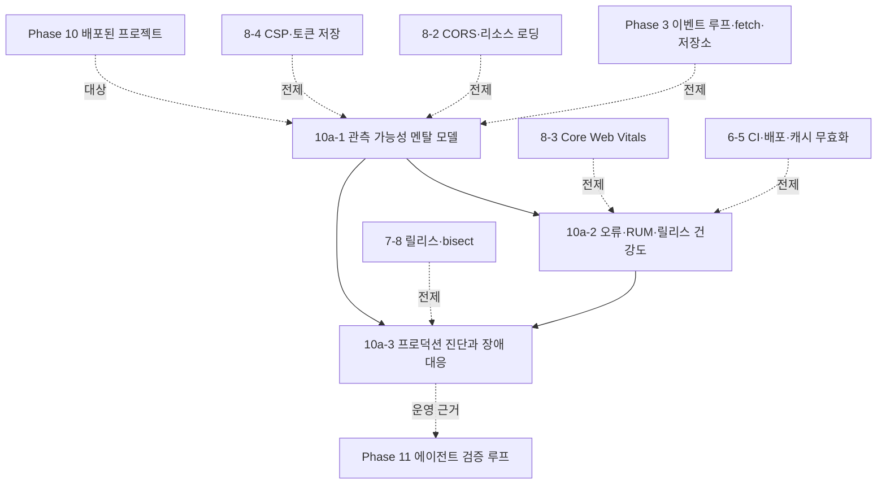

# Phase 10a — 프론트엔드 관측 가능성과 프로덕션 장애 진단 학습 과정 기획

> ROADMAP.md의 Phase 10a(2주, 문서 3개)를 실제 집필 가능한 수준으로 구체화한 기획 문서다.
> 각 문서의 주제 범위, 핵심 논점, 문서 간 의존 관계, 실습 과제 설계, 집필 기준을 정의한다.

---

## 1. 기획 전제

### 이 Phase가 커리큘럼에 존재하는 이유

Phase 8은 **개발자가 통제하는 환경**에서 성능을 계측한다. DevTools를 열고, 네트워크를 스로틀링하고, trace를 찍는다. Phase 10은 프로젝트를 **배포하는 지점까지** 다룬다. 그 사이에 비어 있는 것이 배포 이후의 피드백 루프다.

배포된 코드는 개발자가 열어 볼 수 없는 환경에서 실행된다. 5년 된 Android 기기, 지하철 3G, 광고 차단 확장, 사내 프록시, 번역 확장이 DOM을 바꾼 페이지. 이 환경에서 발생한 오류는 재현 요청("어떻게 하셨나요?")으로는 대부분 회수되지 않는다. 사용자는 재현 절차를 기억하지 못하고, 다수는 신고 대신 이탈한다.

Phase 10a는 이 간극을 **증거 수집 시스템 설계 문제**로 다룬다. "어떤 SaaS를 붙일까"가 아니라, 무엇을 신호로 정의하고, 어떤 차원(dimension)을 붙여 수집하며, 어디까지 표본을 줄이고, 어떤 임계를 넘으면 사람을 깨우고, 무슨 근거로 릴리스를 되돌릴지를 설계한다.

### 독자 상황 분석

독자는 5년차 이상 경력 개발자다. 백엔드·모바일 출신이라면 **서버 관측은 이미 안다** — 로그 수집기, APM, 대시보드, on-call 로테이션, 포스트모템을 경험했을 가능성이 높다. 그래서 이 Phase는 관측 가능성 일반론을 처음부터 설명하지 않는다. 대신 **프론트엔드에서 무엇이 다른가**에 집중한다.

- **이미 아는 것**: 로그/메트릭/트레이스의 구분, 대시보드와 알림의 존재 이유, SLO와 에러 버짓의 개념, 장애 대응 절차의 큰 그림.
- **모르는 것 (이 Phase의 가치)**: ① 클라이언트는 **신뢰할 수 없는 리포터**다. 자기 자신이 죽으면 보고하지 못하고(생존 편향), 보고 내용은 사용자가 조작할 수 있고, 광고 차단기가 전송을 막고, 네트워크가 끊기면 소실된다. ② 실행 환경이 통제 불가능하게 **다양**하다. 서버는 우리가 고른 런타임 하나지만, 클라이언트는 브라우저 × 버전 × 기기 × 네트워크 × 확장의 곱집합이다. ③ **배포와 실행 시점이 분리**된다. 서버는 배포하면 구 버전이 사라지지만, 프론트엔드는 오래된 탭과 캐시된 번들이 며칠씩 살아 있다. ④ 사용자 경험 지표가 **분포**로만 의미를 가진다. 평균 LCP는 거의 항상 거짓말이다.
- **흔한 함정**: ① 오류 추적 SDK를 붙이고 끝낸다 — 릴리스 식별과 source map 업로드가 없어 스택 트레이스가 `main.a3f9.js:1:28471`로만 남는다. ② 알림을 오류 발생 "개수"에 건다 — 봇과 확장 프로그램이 만든 잡음에 파묻혀 알림을 끈다. ③ `Script error.`를 원인 불명으로 방치한다. ④ Lighthouse 점수를 운영 지표로 쓴다. ⑤ 장애가 끝나면 원인만 고치고 **탐지 실패**는 회고하지 않는다. ⑥ 개인정보와 토큰이 오류 컨텍스트에 그대로 실려 나간다.

### 2주 배분

| 주차 | 문서 | 실습 |
|------|------|------|
| 1주차 | 10a-1 관측 가능성 멘탈 모델, 10a-2 오류·RUM·릴리스 건강도 | 텔레메트리 계층 설계, 오류·CWV 수집 연결, 릴리스 식별과 source map 파이프라인, 상관관계 ID 전파, 대시보드 구성 |
| 2주차 | 10a-3 프로덕션 진단과 장애 대응 | SLI/SLO와 알림 임계 확정, 오류 또는 성능 회귀 주입, 탐지·진단·완화·롤백 수행, 장애 분석 리포트와 재발 방지 조치 |

Phase 10a는 Phase 10의 산출물(배포된 프로젝트) 위에서 진행하는 것을 기본으로 한다. Phase 10 프로젝트가 없으면 Phase 8의 Next.js 미니 프로젝트나 실무 저장소를 대상으로 삼는다.

---

## 2. 문서별 상세 기획

각 문서는 [.agents/content-writing.md](../.agents/content-writing.md)의 기본 구조를 따른다. 세 문서 모두 **표준 웹 플랫폼 API(1차 자료)를 먼저 세우고, 상용 도구는 그 API 위의 선택지로** 다룬다. 특정 벤더의 대시보드 조작법은 다루지 않는다.

### 10a-1. 관측 가능성 멘탈 모델 — `docs/phase-10a/01-observability-mental-model.md`

- **핵심 질문**: 프로덕션에서 무슨 일이 일어났는지 알아내려면 무엇을 미리 심어 둬야 하는가 — 클라이언트가 신뢰할 수 없는 리포터라는 제약 아래에서 어떤 신호가 증거가 되는가?
- **다룰 범위**:
  - **모니터링과 관측 가능성의 구분**: 모니터링은 "예상한 실패가 일어났는가"(알려진 질문에 대한 사전 정의 지표), 관측 가능성은 "예상하지 못한 상태를 사후에 질의할 수 있는가"(고차원 컨텍스트 보존)를 다룬다. 대시보드 개수가 아니라 **새 질문을 코드 배포 없이 던질 수 있는가**가 판정 기준이다.
  - **세 가지 신호의 역할 분담**: 메트릭(집계된 수치, 저렴하고 카디널리티에 취약), 로그/이벤트(개별 사건, 컨텍스트 풍부하고 비쌈), 트레이스(하나의 작업이 계층을 가로지른 인과 경로). 프론트엔드에서는 여기에 **세션 단위 사용자 여정**과 **replay**가 추가된다. 각 신호가 답할 수 있는 질문과 답할 수 없는 질문을 표로 정리한다.
  - **브라우저가 제공하는 1차 계측 표면**: `PerformanceObserver`와 각 entry type(`navigation`, `resource`, `paint`, `largest-contentful-paint`, `layout-shift`, `event`, `longtask`, `long-animation-frame`), `window.onerror`/`error`/`unhandledrejection` 이벤트, `reportError()`, Reporting API(`Reporting-Endpoints` + `ReportingObserver`)로 오는 CSP 위반·deprecation·intervention·crash 보고. 이 표면이 SDK의 실체다.
  - **전송 계층**: `navigator.sendBeacon()`과 `fetch(..., { keepalive: true })`의 차이와 크기 제한, `visibilitychange`/`pagehide`에서 flush 해야 하는 이유(모바일에서 `beforeunload`가 신뢰할 수 없는 이유), bfcache 복원(`pageshow`의 `persisted`)이 세션 모델을 어떻게 깨는지.
  - **상관관계(correlation)**: 브라우저에서 생성한 요청이 서버 로그의 어느 줄과 같은 사건인지 잇는 방법. W3C Trace Context의 `traceparent`/`tracestate` 형식, 클라이언트에서 span을 시작할 때의 비용(cross-origin 요청에 커스텀 헤더를 붙이면 preflight가 생긴다), 반대 방향으로 서버가 `Server-Timing`으로 request/trace id를 돌려주는 패턴과 `Timing-Allow-Origin` 제약. 세션 ID, 릴리스 ID, 사용자 ID(가명)의 계층.
  - **경계 조건 — 클라이언트 텔레메트리가 구조적으로 놓치는 것**: 생존 편향(번들 로드 실패, JS 파싱 오류, 완전한 네트워크 단절은 자기 자신을 보고할 수 없다), 광고 차단기와 프라이버시 확장이 수집 엔드포인트를 차단하는 문제(1st-party 프록시 엔드포인트), 시계 왜곡, 봇 트래픽, 확장 프로그램이 주입한 스크립트가 만드는 오류. 이 공백을 CDN/서버 로그, 합성 모니터링(synthetic), HTML `<head>`의 인라인 초기 오류 핸들러로 메우는 방법.
  - **비용·샘플링·프라이버시**: 카디널리티 폭발(URL에 ID가 그대로 들어간 경로, 사용자 ID를 태그로 붙이는 실수), head-based sampling과 tail-based sampling, 오류는 전수·성능은 표본이라는 일반적 배분, 표본율이 SLO 판정에 주는 통계적 한계. 개인정보 최소 수집, PII 스크러빙, replay 마스킹, 지역별 데이터 보관 규제, 보존 기간과 비용의 관계.
- **다루지 않을 범위**: 서버·인프라 관측(백엔드 APM 구성, 로그 파이프라인 운용), 특정 SaaS 제품의 설정 화면, 데이터 웨어하우스·프로덕트 애널리틱스(전환율 분석), A/B 테스트 설계.
- **경력자 연결**: 서버 APM은 자기 프로세스 안에서 완결적으로 관측하지만, 브라우저 계측은 **관측 대상이 관측자를 호스팅하는 구조**다. 관측 코드가 메인 스레드를 점유하면 그 자체가 INP를 악화시키고, 관측 대상이 크래시하면 관측도 함께 죽는다. 이 자기참조적 제약이 프론트엔드 관측 설계의 출발점이다.
- **의존**: [3-5](../docs/phase-3/05-event-loop.md) 이벤트 루프, [3-8](../docs/phase-3/08-network-apis.md) fetch, [3-10](../docs/phase-3/10-memory-and-storage.md) 저장소, [8-2](../docs/phase-8/02-network-deep-dive.md) CORS와 preflight, [8-3](../docs/phase-8/03-web-performance.md) lab/field 구분과 CWV, [8-4](../docs/phase-8/04-web-security.md) CSP와 토큰 저장.

### 10a-2. 오류·RUM·릴리스 건강도 — `docs/phase-10a/02-errors-rum-and-release-health.md`

- **핵심 질문**: 사용자에게 실제로 일어난 실패와 느림을 어떻게 해석 가능한 신호로 만드는가 — 그 신호를 릴리스에 연결해 "이번 배포가 나쁜가"를 언제 판정할 수 있는가?
- **다룰 범위**:
  - **오류 수집의 실제 경로**: `window.addEventListener('error')`가 잡는 것(런타임 예외)과 잡지 못하는 것(리소스 로드 실패는 캡처 단계에서만, `target`으로 구분), `unhandledrejection`으로 오는 Promise 거부, `try/catch`로 삼켜져 아무 데도 나타나지 않는 오류, React error boundary와 `onCaughtError`/`onUncaughtError`/`onRecoverableError`의 관계. 프레임워크 경계에서 오류가 사라지는 지점을 추적한다.
  - **`Script error.` 문제**: cross-origin 스크립트의 오류는 메시지·파일·줄 정보가 제거된다. 해결은 응답에 `Access-Control-Allow-Origin`을 주고 `<script crossorigin="anonymous">`로 요청하는 것. 왜 이 제약이 생겼는지(cross-origin 스크립트의 오류 문자열로 정보를 유출할 수 있다)까지 설명한다.
  - **스택 트레이스를 복원하는 파이프라인**: 번들·minify된 스택을 원본으로 되돌리는 source map 처리. `sourceMappingURL`을 공개 배포하지 않고 빌드 산출물만 업로드하는 hidden source map 구성(Vite `build.sourcemap: 'hidden'` 등), 빌드 시점에 주입하는 릴리스 식별자(보통 Git SHA), 업로드된 map과 실행 중 번들을 잇는 키. 릴리스 식별이 없으면 어떤 진단도 배포와 연결되지 않는다는 점을 강조한다.
  - **오류 그룹화(fingerprinting)**: 같은 결함의 수천 개 이벤트를 하나의 이슈로 묶는 규칙(스택 상위 프레임 + 정규화된 메시지), 그룹화가 실패하는 전형(메시지에 ID·타임스탬프가 섞임, 익명 함수와 인라인 스크립트, 동적 청크 이름), 반대로 과도하게 묶여 서로 다른 원인이 한 이슈가 되는 경우. 커스텀 fingerprint를 언제 손대야 하는가.
  - **잡음 분리**: 확장 프로그램 오류(`chrome-extension://` 프레임), 봇/크롤러, 취소된 요청(`AbortError`), 네트워크 단절로 인한 `TypeError: Failed to fetch`, ResizeObserver 루프 경고처럼 **행동을 바꿀 수 없는 신호**를 걸러 내는 기준. 필터링은 "무시"가 아니라 별도 버킷으로 관측한다.
  - **RUM과 CWV 분포**: `web-vitals` 라이브러리로 LCP/INP/CLS를 수집할 때의 실제 동작(bfcache 복원 처리, `visibilitychange` flush, 최종 값 확정 시점), attribution build가 제공하는 원인 정보(LCP 요소와 subpart, INP를 유발한 요소·이벤트·LoAF 스크립트). **p75를 route·기기·네트워크·릴리스 차원으로 나눠 보지 않으면 개선 대상이 보이지 않는다**는 점을 사례로 보인다.
  - **사용자 영향 기반 SLI/SLO**: SLI를 `좋은 이벤트 / 유효한 이벤트`로 정의하는 형식, 프론트엔드에서 쓸 만한 SLI 후보(핵심 플로우 완료율, 세션 무오류율/crash-free session, route별 LCP·INP가 임계 이하인 비율, 클라이언트 관점 API 성공률), 각 후보의 측정 가능성과 편향. SLO 목표와 기간, 에러 버짓, multi-window multi-burn-rate 알림이 "5분간 오류 급증" 같은 단순 임계보다 나은 이유. 알림은 **원인이 아니라 사용자 영향**에 걸고, 진단은 대시보드에서 한다는 원칙.
  - **릴리스 건강도**: 배포 직후 어떤 지표를 얼마 동안 보고 승격/롤백을 판정할 것인가. 새 릴리스에서만 나타난 이슈(regression) 판정, 채택률(adoption)이 낮은 초기에 비율 지표가 흔들리는 문제, 캐시된 구 번들과 오래된 탭 때문에 릴리스가 깔끔하게 교체되지 않는 프론트엔드 특유의 조건, 청크 404(`ChunkLoadError`)가 배포 때마다 발생하는 이유와 대응.
- **다루지 않을 범위**: 백엔드 SLO 운영 전반, 로그 스토리지 설계, 특정 SaaS의 요금제 비교, 프로덕트 지표(리텐션·퍼널) 분석.
- **경력자 연결**: 서버에서 5xx 비율은 서버가 직접 센다. 프론트엔드에서 "실패율"은 **실패한 클라이언트가 스스로 보고해야** 집계되므로, 분모가 항상 과소 추정된다. SLI를 정의할 때 분모를 무엇으로 잡을 수 있는지부터 검증해야 한다.
- **의존**: 10a-1의 신호 모델과 상관관계 ID, [8-3](../docs/phase-8/03-web-performance.md) CWV 정의와 LCP subpart, [6-5](../docs/phase-6/05-ci-and-deployment.md) CI와 배포·캐시 무효화, [5-4](../docs/phase-5/04-effects.md) race condition과 취소, [10-2](../docs/phase-10/02-code-quality-and-review.md) 품질 gate.

### 10a-3. 프로덕션 진단과 장애 대응 — `docs/phase-10a/03-production-diagnostics-and-incidents.md`

- **핵심 질문**: 신호는 잡혔는데 원인이 어디인지 모를 때 어떤 순서로 계층을 좁히는가 — 원인을 모르는 상태에서도 사용자 영향을 먼저 줄이려면 무엇을 준비해 둬야 하는가?
- **다룰 범위**:
  - **진단은 이분법의 연속이다**: 무작정 코드를 읽지 않고 신호의 차원으로 가설 공간을 반씩 줄인다. 시간(언제부터), 릴리스(특정 버전에서만), 대상(특정 route/브라우저/기기/지역/네트워크), 계층(클라이언트 코드 / 정적 자산·CDN / API·백엔드 / 서드파티 / 사용자 환경). 각 축에서 "이 차원으로 나눴을 때 격리되는가"를 묻는 절차를 명시한다.
  - **계층별 판별 증거**: 특정 릴리스에서만 발생하는가(릴리스 차원 비교), 자산 로딩 실패인가(`resource` 오류 이벤트, CDN 로그, `ChunkLoadError`), API 경계 문제인가(클라이언트 관점 실패율과 서버 5xx 비율의 불일치 — 그 간극이 네트워크·CORS·타임아웃·프록시를 가리킨다), 서드파티인가(스크립트 도메인별 오류·LoAF 귀속), 브라우저 특정 버그인가(User-Agent/버전 분포와 신규 릴리스 타이밍).
  - **성능 회귀 진단**: 필드 지표가 나빠졌을 때 lab에서 재현하는 절차, LCP subpart와 INP attribution으로 조치 계층을 고르는 법, "번들이 커졌다"를 확인하는 배포 간 자산 크기 비교, 데이터 지연이 원인일 때 서버 타이밍과의 상관. Phase 8-3의 개선 루프를 **회귀 진단 루프**로 뒤집어 적용한다.
  - **탐지 → 분류 → 완화 → 복구 흐름**: 심각도(severity) 판정 기준을 사용자 영향으로 정의하기, 역할(incident commander / communications / operations)을 1인 프로젝트 규모로 축소해 적용하는 법, **원인 규명보다 완화가 먼저**라는 원칙과 그 예외.
  - **완화 수단의 계층과 비용**: 롤백(가장 빠르지만 스키마·데이터 마이그레이션이 얽히면 불가), 기능 플래그로 끄기(사전 준비 필요), CDN 캐시 무효화·이전 자산 서빙, 트래픽 일부 차단, 서드파티 스크립트 제거, hotfix. 각 수단의 준비 비용과 되돌릴 수 있는 범위를 비교한다. **롤백 가능한 배포를 사전에 설계하는 것이 장애 대응의 절반**임을 강조한다.
  - **타임라인 작성**: 발생 시각, 최초 신호 발생 시각, 탐지 시각, 인지 시각, 완화 시각, 복구 시각을 나누는 이유. 탐지 지연(MTTD)이 크면 원인 수정이 아니라 **관측 설계**가 조치 대상이다.
  - **비난 없는 회고(blameless postmortem)**: 사람의 실수를 원인으로 적으면 시스템이 학습하지 못하는 이유, "왜 이 변경이 리뷰와 CI를 통과했는가"까지 올라가는 기여 요인 분석, 재발 방지 조치를 **소유자와 기한이 있는 항목**으로 만드는 규칙, 조치의 계층(탐지 개선 / 완화 수단 추가 / 결함 자체 제거 / 유입 차단)을 구분해 최소 한 개씩 배치하기.
  - **경계 조건**: 재현되지 않는 오류를 언제 닫을 것인가, 신호는 있지만 영향이 없는 오류(무해한 잡음)에 시간을 쓰는 함정, 알림 피로(alert fatigue)가 탐지 능력을 실제로 파괴하는 과정, 회고 조치가 쌓이기만 하고 실행되지 않는 실패 모드.
- **다루지 않을 범위**: 조직 차원의 on-call 로테이션 설계와 보상 정책, 인프라 장애 대응(DB·네트워크 운영), 법적 고지·고객 커뮤니케이션 템플릿 일반론, 재해 복구(DR) 계획.
- **경력자 연결**: 서버 장애는 대개 스택 트레이스와 로그가 원인 지점까지 데려다준다. 프론트엔드 장애는 **원인 코드가 우리 저장소에 없을 수도 있다** — 브라우저 업데이트, 서드파티 스크립트 배포, CDN 설정, 광고 차단 규칙 변경. 그래서 "우리 코드를 의심하기 전에 무엇이 바뀌었는가"를 묻는 변경 축이 진단의 1순위가 된다.
- **의존**: 10a-1의 신호 설계, 10a-2의 릴리스 식별·SLI·알림, [7-8](../docs/phase-7/08-release-debugging-and-repo-operations.md) `bisect`와 릴리스 태그, [6-5](../docs/phase-6/05-ci-and-deployment.md) 배포·캐시 무효화, [8-3](../docs/phase-8/03-web-performance.md) 성능 진단 루프, [10-2](../docs/phase-10/02-code-quality-and-review.md) 품질 gate.

---

## 3. 문서 간 의존 관계

- 집필 순서는 번호 순서(10a-1 → 10a-3)를 따른다. 10a-1이 "무엇을 신호로 삼고 어떻게 보낼 것인가"를 세우고, 10a-2가 그 신호를 오류·성능·릴리스 차원의 판정 가능한 지표로 만든다. 10a-3은 그 지표로 실제 사고를 진단하고 대응·회고까지 닫는다.
- Phase 8과의 경계: 8-3은 **lab 중심의 성능 개선 루프**, 10a-2는 **field 중심의 회귀 탐지**다. CWV의 정의·기준값·subpart 분해는 8-3에서 이미 세웠으므로 반복하지 않고 링크로 위임한다. 10a는 "그 지표를 실사용자 분포로, 릴리스 차원과 함께 본다"에서 시작한다.
- Phase 11과의 경계: 11-5는 **에이전트 작업 결과의 검증 증거**를 다루고, 10a는 **배포된 제품의 운영 증거**를 다룬다. 둘 다 "진술이 아니라 증거"라는 원칙을 공유하지만 대상이 다르다. 상호 참조는 하되 내용을 복제하지 않는다.
- Phase 10과의 경계: 10-2의 품질 gate는 배포 **전** 검증이고, 10a는 배포 **후** 검증이다. 10-1의 ADR 형식을 재사용해 관측 설계 결정과 SLO 목표를 기록한다.

---

## 4. 실습 과제 설계

ROADMAP의 "텔레메트리 연결 + 대시보드·알림 + 회귀 주입 + 장애 분석 리포트"를 문서 진도와 연동한다. 상세 체크리스트는 [`exercises/phase-10a`](../exercises/phase-10a/README.md)에서 관리한다.

### 과제 A — 텔레메트리 설계와 연결 (1주차, 10a-1 병행)

- 대상 프로젝트(Phase 10 산출물 권장)의 관측 설계 노트를 작성한다. 답해야 할 질문 목록, 각 질문에 필요한 신호, 신호에 붙일 차원, 샘플링 정책, 수집하지 않기로 한 항목과 그 이유를 포함한다.
- 오류 수집을 연결한다. 전역 `error`/`unhandledrejection`, 리소스 로드 실패, React error boundary를 모두 덮고, 각 경로가 실제로 도달하는지 의도적 오류로 검증한다.
- 릴리스 식별자를 빌드에 주입하고 source map 업로드 파이프라인을 구성한다. 배포된 자산에 `sourceMappingURL`이 노출되지 않는지 확인한다.
- 상관관계 ID를 설계한다. 세션 ID, 릴리스 ID, 요청 단위 식별자를 정의하고, 클라이언트 오류에서 서버 로그로 이동할 수 있는 경로를 최소 한 개 실증한다.
- 개인정보 점검을 수행한다. 전송 페이로드를 직접 캡처해 토큰·이메일·주소·입력값이 포함되지 않는지 확인한다.

### 과제 B — RUM·SLI·알림 (1주차 후반~2주차, 10a-2 병행)

- Core Web Vitals를 field에서 수집하고 route·기기·릴리스 차원으로 나눈 대시보드를 만든다. 평균이 아니라 p75(가능하면 p95까지)를 본다.
- SLI를 2개 이상 정의하고 각각의 분자·분모·유효 이벤트 조건, 측정 편향을 문서화한다. SLO 목표와 기간, 에러 버짓을 정한다.
- 알림을 최소 2개 만든다. 하나는 오류/실패율 기반, 하나는 성능 또는 릴리스 건강도 기반. 각 알림에 대해 임계 근거, 예상 오탐, 알림을 받은 사람이 처음 열어 볼 대시보드를 기록한다.
- 오류 그룹화를 점검한다. 상위 이슈 5개를 보고 과도 분할/과도 병합이 있는지 판단하고, 잡음 필터 기준을 명시한다.

### 과제 C — 회귀 주입과 장애 대응 (2주차, 10a-3 병행)

- 통제된 회귀를 최소 2개 주입한다. 하나는 오류 계열(특정 조건에서만 발생하는 런타임 예외, 청크 로드 실패 등), 하나는 성능 계열(불필요한 blocking 자산, 큰 동기 작업, 데이터 지연 등). 프로덕션 사용자에게 영향을 주지 않도록 staging 또는 소수 트래픽에서 수행한다.
- 주입 사실을 잊은 상태로 신호부터 출발해 진단한다. 어떤 알림이 먼저 울렸는지, 어떤 차원으로 좁혔는지, 몇 단계 만에 계층을 특정했는지 기록한다.
- 완화 또는 롤백을 실행하고 소요 시간을 측정한다. 롤백이 불가능한 조건이 있었다면 그것도 기록한다.
- 장애 분석 리포트를 작성한다. 타임라인(발생·최초 신호·탐지·인지·완화·복구), 사용자 영향 추정과 그 근거, 증거 링크, 기여 요인, 계층별 재발 방지 조치를 포함한다.
- 관측 설계 자체를 회고한다. 탐지가 늦었다면 어떤 신호가 없었는지, 알림이 울리지 않았다면 임계가 왜 잘못됐는지를 조치 항목으로 만든다.

### 산출물

- **관측 설계 노트**: 질문 → 신호 → 차원 → 샘플링 → 제외 항목의 매핑과 근거
- **연결된 텔레메트리**: 오류·RUM 수집, 릴리스 식별, source map, 상관관계 ID
- **운영 대시보드와 알림 정의**: SLI/SLO, 임계 근거, 대응 진입점
- **장애 분석 리포트**: 타임라인, 영향, 증거, 기여 요인, 재발 방지 조치

### 완성 기준 (Definition of Done)

- [ ] 관측 설계 노트에 "이 신호로 답할 질문"과 "수집하지 않기로 한 것"이 모두 적혀 있다
- [ ] 전역 오류·Promise 거부·리소스 실패·컴포넌트 오류 경계가 모두 수집 경로에 연결되고 실증됐다
- [ ] 릴리스 식별자와 source map으로 스택 트레이스가 원본 위치로 복원된다
- [ ] 클라이언트 오류에서 서버 로그로 이동할 수 있는 상관관계 경로가 실증됐다
- [ ] 전송 페이로드에 개인정보·토큰이 없음을 직접 확인했다
- [ ] CWV가 route·기기·릴리스 차원으로 분해된 대시보드가 있다
- [ ] SLI 2개 이상에 분자·분모·측정 편향이 문서화되어 있다
- [ ] 알림 2개 이상에 임계 근거와 대응 진입점이 있다
- [ ] 통제된 회귀 2개 이상을 주입하고 신호부터 진단해 원인을 특정했다
- [ ] 완화 또는 롤백을 실행하고 소요 시간을 측정했다
- [ ] 장애 분석 리포트에 타임라인·영향·증거·기여 요인·재발 방지 조치가 있다
- [ ] 재발 방지 조치에 탐지 개선 항목이 최소 1개 포함되어 있다

---

## 5. 공통 집필 기준 (Phase 10a 특화)

[.agents/content-writing.md](../.agents/content-writing.md)에 더해, Phase 10a에서 특히 지킬 것:

- **표준 API를 먼저, 제품은 나중에**: `PerformanceObserver`, `ReportingObserver`, `sendBeacon`, Trace Context처럼 브라우저와 W3C가 정의한 표면을 먼저 세운다. Sentry·Datadog·Grafana Faro 같은 제품은 "이 표면을 어떻게 묶어 주는가"의 예시로만 언급하고, 특정 제품의 설정 화면을 따라 하게 하지 않는다. 제품을 언급할 때는 그 기능이 표준 API 위의 어느 계층인지 밝힌다.
- **클라이언트는 신뢰할 수 없는 리포터라는 전제를 반복 적용**: 모든 수집 방식마다 "이 신호가 도달하지 못하는 경우"를 함께 쓴다. 생존 편향, 차단, 소실, 조작 가능성을 빼놓고 지표를 제시하지 않는다.
- **평균을 쓰지 않는다**: 사용자 경험 지표는 분포로 다룬다. p75/p95, 차원 분해, 표본 수에 따른 신뢰도를 함께 제시한다. 단일 숫자로 품질을 대표하는 서술을 넣지 않는다.
- **알림은 원인이 아니라 영향에 건다**: 지표 설계 예시에서 "CPU가 높다"류의 원인 지표 알림과 "핵심 플로우 성공률이 SLO를 소진하고 있다"류의 영향 지표 알림을 구분해 보인다. 알림 피로를 비용으로 명시한다.
- **비용과 개인정보를 항상 함께 제시**: 수집 항목을 늘리는 제안에는 저장 비용, 카디널리티, 개인정보 위험, 메인 스레드 비용을 붙인다. "다 수집하고 나중에 본다"를 기본값으로 제시하지 않는다.
- **재현 가능한 관찰 절차 제공**: 코드 예제는 로컬에서 확인 가능한 최소 단위로 준다(오류 이벤트가 실제로 발생하는지, `sendBeacon`이 언제 전송되는지, `PerformanceObserver`가 무엇을 내보내는지). DevTools Network 패널에서 비콘 요청을 확인하는 절차처럼 독자가 직접 볼 수 있는 방법을 붙인다.
- **수치와 기준값은 근거와 함께**: SLO 목표, 알림 임계, 샘플링 비율에 "업계 표준"이라는 표현을 쓰지 않는다. 어떤 사용자 영향에서 유도했는지, 어떤 조건에서 조정해야 하는지를 쓴다.
- **1인/소규모 프로젝트로 축소 가능하게**: on-call 팀이 없는 독자가 실습할 수 있도록, 역할과 절차를 규모에 맞게 줄이는 방법을 함께 제시한다. 대기업 SRE 조직을 전제한 서술로 끝내지 않는다.
- **1차 자료 우선**: W3C Trace Context, W3C Reporting API·Performance Timeline·Event Timing·Long Animation Frames, WHATWG HTML(오류 이벤트와 `sendBeacon`), MDN, web.dev, Google SRE Workbook, OpenTelemetry 공식 문서를 우선한다. 브라우저 지원이 갈리는 API(LoAF, Reporting API 등)는 현재 지원 상태와 대체 수단을 함께 밝힌다.
- **확인 문제 방향**: "이 오류 그룹이 하나로 묶인 것은 왜 잘못됐는가", "클라이언트 실패율과 서버 5xx가 다르면 무엇을 의심하는가", "이 알림 임계가 오탐을 만드는 조건은 무엇인가", "탐지가 40분 늦은 이 타임라인에서 조치 대상은 무엇인가"처럼 진단·판단형 문제를 우선한다.

---

## 6. 진행 체크리스트

- [x] 10a-1 `01-observability-mental-model.md`
- [x] 10a-2 `02-errors-rum-and-release-health.md`
- [x] 10a-3 `03-production-diagnostics-and-incidents.md`
- [x] `exercises/phase-10a/` 과제 안내 문서
- [x] `docs/.vitepress/navigation.ts`의 Phase 10a 레이블·정렬 확인
- [x] PROGRESS.md 진행 현황 갱신
